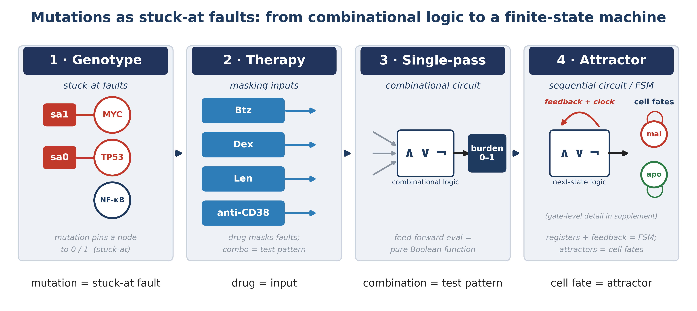

# Mutations as Stuck-at Faults — a Logic-Circuit / FSM Model of Multiple Myeloma


Code, data, hardware description, and figures for

> **Mutations as Stuck-at Faults: A Logic-Circuit and Finite-State-Machine
> Formalization of Boolean Cancer Signaling Networks, with HDL Export —
> A Multiple Myeloma Case Study.**
> Sang Hoon Chung, Madhurima Mondal, Norman Reeves, and Aniruddha Datta.
> *2026 IEEE International Conference on Bioinformatics and Biomedicine (BIBM)*,
> Dallas, TX, USA, December 2026 (short paper).

We read a multiple-myeloma (MM) signaling network as a **logic circuit**.
Evaluated feed-forward it is a **combinational circuit** that outputs an
oncogenic-burden score; restoring the IRF4–MYC feedback loop and an absorbing
apoptosis latch turns it into a **sequential circuit / finite-state machine
(FSM)** whose attractors are cell fates. The FSM is exported as **synthesizable
Verilog**, checked against the Python reference, so standard
electronic-design-automation (EDA) tools — equivalence checking, model checking,
and automatic test-pattern generation (ATPG) — can act on the network directly.

This work builds on the pathway-logic / stuck-at-fault line of Layek *et al.*
(Bioinformatics 2011) and the SAT-based ATPG of Lin & Khatri (BMC Genomics 2012).
Our additions are the **synthesizable HDL artifact**, the **explicit
attractor/FSM extension with quantified multistability**, and the **MM case
study**. This repository also hosts the paper's **supplementary material**.



## The idea in one table

| Biology | Digital logic |
|---|---|
| oncogenic mutation | **stuck-at fault** (a node pinned to 0/1) |
| targeted drug | **input** that masks faults |
| drug combination | **multi-fault test pattern** |
| single-pass evaluation | **combinational circuit** → burden score |
| feedback + clock | **sequential circuit / FSM** |
| cell fate (survive / die) | **attractor** (fixed point or cycle) |
| finding a killing combination | **ATPG** (test-pattern generation) |

## Model at a glance

- 22 internal state nodes, 8 tumor readouts, 5 drug inputs
  (isatuximab, daratumumab, bortezomib, dexamethasone, lenalidomide).
- 22 faults: 18 stuck-at-1 oncogenic nodes, TP53 stuck-at-0, and three context
  faults (PTEN loss, BIM deletion, CRBN loss).
- Intrinsic scope: no immune effector mechanisms, single clone, Boolean (no dose).

## Repository layout

```
.
├── src/        Python model + analyses (run scripts from this folder)
├── hdl/        synthesizable Verilog FSM + testbenches
├── data/       network provenance + reference result tables (CSV)
├── figures/    all paper + supplementary figures (PNG)
└── paper/      LaTeX source of the IEEE BIBM 2026 camera-ready paper (+ figures)
```

## Quickstart

```bash
git clone https://github.com/SangHoonChung/Mutations-as-Stuck-at-Faults.git
cd Mutations-as-Stuck-at-Faults
python3 -m pip install -r requirements.txt
cd src
python3 MM_network_gates.py     # -> "checked 8128 cases, mismatches = 0"
```

The core model uses only the Python standard library; `numpy`, `pandas`, and
`matplotlib` are used by the analysis and figure scripts. The `Makefile` wraps the
common runs (`make all`, `make verilog`, `make figures`).

## Reproducing the paper's results

Run each script from `src/`. Results are printed, and CSV/PNG outputs are written
to `src/` (reference copies of every CSV are kept in `data/`).

| Script | Reproduces | Runtime* |
|---|---|---|
| `MM_network_gates.py` | gate netlist ≡ rule model on all **8,128** fault × drug cases (0 mismatches) | < 1 s |
| `MM_verilog_equiv.py` | Verilog FSM ≡ Python reference on **20,000** random cases (0 mismatches; needs Icarus Verilog) | ~2 s |
| `MM_attractor_screen.py` | single-pass vs attractor screen (352 conditions); multistable fraction; heatmap | ~15 s |
| `MM_exact_attractors.py` | exact attractor enumeration: multistable fraction **24.2 %**, matching sampling | ~2 min |
| `make_compare_compact.py` | single-pass vs attractor comparison figure (r = 0.76); run after the screen | < 5 s |
| `MM_attractor_ci.py` | Monte-Carlo 95 % CIs; isatuximab ≈ daratumumab (Δ = 0.0003) | ~25 s |
| `MM_table1_fix.py` | Table I with shared seeds (identically encoded regimens give identical rows) | < 5 s |
| `MM_baseline_null.py` | drug-count baseline (ρ = 0.856, zero within-tier resolution) | ~10 s |
| `MM_null_model.py` | randomized-rule null, N = 200 (ρ ≈ 0.05); run after `MM_baseline_null.py` | ~2.5 min |
| `MM_async_robust.py` | synchronous vs asynchronous update (96 % outcome agreement; ranking ρ = 0.97–1.00 across seeds) | ~30 s |
| `MM_rule_perturb.py` | rule / structure perturbation (median ρ = 0.96) | ~40 s |
| `MM_readout_sens.py` | readout robustness (leave-one-out ρ ≥ 0.97) | < 5 s |
| `MM_atpg.py` | exhaustive ATPG: 21/22 faults detectable, STAT3 undetectable, minimal cover = Btz + Dex | < 5 s |

\* single core, measured on a recent laptop-class CPU.

`data/MM_concordance.csv` backs the literature-concordance table (6/8 agree; two
predictions fall outside the intrinsic scope), and
`data/MM_pathway_merge_edgelist.md` documents node-level provenance.

**Note on Table I scale.** `MM_table1_fix.py` recomputes Table I with a shared seed
per condition. Absolute values differ in scale from the submitted table (e.g., VRd
0.008 vs 0.019), but every relational conclusion — including the merged
anti-CD38 rows — is unchanged.

## Hardware description (Verilog)

`hdl/MM_attractor.v` is the exported FSM: a 22-bit state register with per-node
stuck-at ports (`sa_en`, `sa_val`), drug input pins, and an absorbing apoptosis
latch. Two testbenches are provided (requires
[Icarus Verilog](https://steveicarus.github.io/iverilog/)):

```bash
# 1) equivalence: Verilog next-state logic vs the Python reference
cd src && python3 MM_verilog_equiv.py          # "checked 20000 cases, mismatches = 0"

# 2) demo: clock example conditions to their attractors
cd hdl && iverilog -o mm_tb MM_attractor.v MM_attractor_tb.v && vvp mm_tb
```

## Supplementary material

The conference paper has a strict page limit; the following are provided here
instead: the integrated pathway map (`figures/MM_integrated_pathway_EN.png`), the
attractor state-transition diagram (`figures/MM_attractor_representation.png`),
the gate-level sequential core (`figures/MM_seq_gate_core.png`), the full
sequential circuit (`figures/MM_sequential_circuit.png`), the attractor-residual
heatmap (`figures/MM_attractor_heatmap.png`), and node-level provenance
(`data/MM_pathway_merge_edgelist.md`).

## Scope and limitations

The model is intrinsic (no immune effector mechanisms, so same-target antibodies
are indistinguishable by construction), single-clone, and Boolean (no dose). Its
regimen rankings are **in silico mechanistic hypotheses**, not fitted predictions:
the literature concordance is a consistency check, and external validation against
genotype-matched patient data (e.g., CoMMpass) or cell-line panels
(DepMap / CTRP / GDSC) is future work.

## Citation

If you use this code, please cite:

```bibtex
@inproceedings{chung2026mutations,
  title     = {Mutations as Stuck-at Faults: A Logic-Circuit and
               Finite-State-Machine Formalization of Boolean Cancer Signaling
               Networks, with HDL Export --- A Multiple Myeloma Case Study},
  author    = {Chung, Sang Hoon and Mondal, Madhurima and Reeves, Norman and
               Datta, Aniruddha},
  booktitle = {Proceedings of the 2026 IEEE International Conference on
               Bioinformatics and Biomedicine (BIBM)},
  year      = {2026},
  note      = {Short paper}
}
```

Please also cite the prior work this builds on: Layek *et al.*, *Cancer therapy
design based on pathway logic*, **Bioinformatics** 27(4):548–555, 2011; and
Lin & Khatri, *Application of Max-SAT-based ATPG to optimal cancer therapy
design*, **BMC Genomics** 13(Suppl 6):S5, 2012.

## License

Released under the MIT License; see [LICENSE](LICENSE).
